# Gradium plugin for LiveKit Agents

Support for [Gradium](https://gradium.ai/)-hosted models in LiveKit Agents.

More information is available in the docs for the
[TTS](https://docs.livekit.io/agents/integrations/tts/gradium/) and [STT](https://docs.livekit.io/agents/integrations/stt/gradium/) integrations.

## Installation

```bash
pip install livekit-plugins-gradium
```

## Pre-requisites

You'll need an API key from Gradium. It can be set as an environment variable: `GRADIUM_API_KEY`.

You also need to deploy a model to Gradium and will need your model endpoint to configure the plugin.

## `STT`: preemptive generation

The STT ends a turn when the server's VAD detects a pause: it asks the server to flush the words
the model still holds, and emits the final transcript on the server's reply. Before that, as soon
as the VAD trips, it sends a `PREFLIGHT_TRANSCRIPT` with the words heard so far. With preemptive generation (on by default), the
LLM request starts earlier and only restarts if the final transcript differs.

To turn it off and only start generation from final transcripts:

```python
from livekit.plugins import gradium

stt = gradium.STT(preflight_trigger=None)
```

### What to expect

In the best case, every word has already been transcribed when the VAD trips, and the LLM
gets its request as soon as the VAD trips instead of when the turn is finalized. The 350 ms
between the trip and the final transcript is measured against the plugin defaults
(`vad_bucket=2`, `vad_threshold=0.9`):

```text
ms              -480        0       300       700     1050        1500    1850
                |           |       |         |       |           |       |
user speech     ████████████                                                   user stops speaking at 0 ms
silence                     ········T·········                                 T: last words transcribed (300 ms); VAD trips at 700 ms
finalize                                      ════════                         flush, then final transcript at 1050 ms

preflight on                                  ────────────────────●            LLM request at 700 ms, first token at 1500 ms
preflight off                                         ────────────────────●    LLM request at 1050 ms, first token at 1850 ms
gain                                                              ◄───────►    first token 350 ms earlier
```

A lower `vad_bucket` or `vad_threshold` makes the VAD trip earlier, closer to the last words.
That ends turns sooner, but a pause in the middle of a sentence is more likely to end the turn
early, and a word still held by the model at the trip makes the final transcript differ from the
preview, which costs a second LLM call. When tuning the VAD parameters, also check the number of
LLM calls to ensure you still benefit from preemptive generation.

### Pauses inside a sentence

By default the first VAD trip ends the turn once the server answers the flush. If the user pauses
mid-sentence and resumes, the sentence is split into two turns and the first LLM request is
wasted. `vad_confirm_steps` trades latency for fewer of those early endings: after the trip, the
turn ends only when the server has answered the flush **and** that many more steps (80 ms each)
had the VAD above `vad_threshold`.

```python
stt = gradium.STT(vad_confirm_steps=3)
```

Steps below the threshold don't count, but don't restart the count either: after the user stops,
the VAD can hover around the threshold for seconds, and that must not hold the turn open. What
keeps the turn open is new words after the flush reply: the user is talking again, the count
restarts, and the next trip flushes again, so words the model held in the meantime are not lost.
The preview is only sent again if the words changed.

The trade-off:

- `0` (default): lowest latency, mid-sentence pauses end the turn.
- `N > 0`: the turn ends once the flush reply has arrived and `N` steps above the threshold have
  followed the trip, so at least `N × 80 ms` after the trip. A pause the user resumes from costs
  an extra flush request, and a second preview if the words changed.
- A sound the model does not transcribe (a breath, an "mm") while the VAD stays above the
  threshold does not keep the turn open.

## `STTExperimental`: end-of-turn detection in the STT

`STTExperimental` decides when the user's turn is over from Gradium's own signals, so the
session needs no separate turn detector. Use it with `turn_detection="stt"` when you want
one model for transcription and turn-taking, in a language the server supports.
It is experimental: read "Known limits" before choosing it over the LiveKit turn
detector.

```python
from livekit.agents import AgentSession, TurnHandlingOptions
from livekit.plugins import gradium

session = AgentSession(
    stt=gradium.STTExperimental(eagerness="balanced", language="en"),
    turn_handling=TurnHandlingOptions(
        turn_detection="stt",
        # the STT has already waited for the silence: do not add the default 0.5 s floor
        endpointing={"min_delay": 0.0},
    ),
    # ... llm, tts, vad, etc.
)
```

After `END_OF_SPEECH` the framework still waits `endpointing.min_delay` (0.5 s by
default), counted from the end of the last word. The STT's own decision usually comes
later than that, so the default delay only slows down the fastest turns; set it to 0
unless you want that floor.

### Presets

`eagerness` picks how much false cut-off risk buys latency: `"responsive"`, `"balanced"`
(the default) or `"prudent"`, calibrated for 10%, 5% and 2% false cut-offs. Measured on
English, which the scorer and the calibration never saw (production Gradium, model
`933b5345@150`), with preflight on as shipped:

| Preset | Hold cut-offs | Cut-offs incl. speech | Turns cut off | Decision, mean / p50 / p90 | `END_OF_SPEECH`, mean / p50 / p90 | Wasted preflights per turn |
|---|---|---|---|---|---|---|
| `responsive` | 9.0% | 20.1% | 17.0% | 719 / 608 / 1,221 ms | 900 / 777 / 1,451 ms | 0.15 (13.8% of turns) |
| `balanced` | 4.6% | 10.0% | 8.8% | 996 / 840 / 1,440 ms | 1,130 / 1,003 / 1,627 ms | 0.13 (11.0% of turns) |
| `prudent` | 2.4% | 4.6% | 4.0% | 1,555 / 1,296 / 3,096 ms | 1,647 / 1,396 / 3,104 ms | 0.04 (4.2% of turns) |

How to read it:

- Latencies are counted from the start of the annotated end-of-turn silence. *Decision*
  is when the state machine commits; *`END_OF_SPEECH`* is when the event reaches the
  session, after the flush reply (312 to 330 ms p50, 346 to 361 ms p90 over five
  real-time runs) unless an eager flush already returned.
- *Hold cut-offs* is eot-bench's false cut-off rate: the share of mid-turn pauses of 0.2
  to 5 s in which the turn was ended. eot-bench cannot see a turn ended while the user is
  still talking, yet more than half of the cut-offs happen there: the learned score was
  trained on silences only and sometimes fires on speech. *Cut-offs incl. speech* counts
  each one as one more cut-off over the same pauses; *turns cut off* is the share of
  turns ended at least once too early. Short replies ("yes", "thank you") are hit hardest: for
  `balanced`, 23% including speech against 5% for the `general` cohort.
- The numbers come from 500 English turns replayed live through the plugin's state
  machine with the flushes really sent. On the full 2,288 English turns with preflight
  off, the same presets are 35 to 95 ms slower than on these 500, so expect the full-set
  numbers to sit that much higher.
- For comparison, on the same audio LiveKit's turn detector v1.1 reaches 824 ms mean
  latency at eot-bench's 5% budget; this scorer, judged the same way (holds only, best
  fixed policy), reaches 874 ms.

Any knob can be changed on top of a preset with `overrides`, for example
`gradium.STTExperimental(eagerness="balanced", overrides={"max_silence": 2.5})`.

### Preflight

All three presets enter `EAGER` before committing: a `flush` returns the words the model
still holds and the STT emits `PREFLIGHT_TRANSCRIPT`, so the session starts the LLM
before the turn is final (`preemptive_generation` is on by default in `AgentSession`). If
the user goes on talking, the next interim cancels that generation.

Measured against the same knobs with preflight off, on the same English turns:

| Preset | Cut-offs incl. speech | Decision | `END_OF_SPEECH` | LLM head start, p50 | Wasted generations |
|---|---|---|---|---|---|
| `responsive` | 20.1% vs 23.6% | +76 ms | -58 ms | 0 ms | 0.15 per turn |
| `balanced` | 10.0% vs 13.5% | +124 ms | -57 ms | 5 ms | 0.13 per turn |
| `prudent` | 4.6% vs 7.6% | +261 ms | +38 ms | 405 ms | 0.04 per turn |

The commit is slower with preflight, because the scores read after a flush separate
pauses from turn ends less well. The final transcript arrives sooner anyway, because the
commit reuses the eager flush instead of waiting about 315 ms for its own reply, and
fewer turns are cut off. The cost is LLM work: one wasted generation every 7 to 25
turns. The framework allows 3 preemptive generations per turn
(`PreemptiveGenerationOptions.max_retries`); no turn in these runs needed more. To turn
preflight off: `overrides={"preflight": False}`.

### Background noise

There is no noise setting; in noise, choose one eagerness level stricter. Measured on 500
English turns with noise mixed in (preflight off; `balanced` is 872 ms and 13.5% in
quiet on these turns):

| Noise | `responsive` cut-offs incl. speech / decision | `balanced` | `prudent` |
|---|---|---|---|
| quiet | 23.6% / 643 ms | 13.5% / 872 ms | 7.6% / 1,294 ms |
| pink, 15 dB SNR | 30.6% / 672 ms | 16.6% / 919 ms | 9.2% / 1,402 ms |
| pink, 5 dB | 36.9% / 688 ms | 19.0% / 953 ms | 10.3% / 1,468 ms |
| babble, 15 dB | 38.9% / 1,229 ms | 17.0% / 2,322 ms | 4.8% / 4,231 ms |
| babble, 10 dB | 42.1% / 1,613 ms | 15.9% / 3,271 ms | 4.1% / 4,910 ms |
| babble, 5 dB | 53.1% / 2,352 ms | 19.7% / 4,537 ms | 8.1% / 5,246 ms |

Steady noise mostly adds cut-offs; a stricter preset brings them back. Background
voices are worse: the model hears them as the user still talking, so the silence clock
never starts and turns end seconds late (with `balanced` at 10 dB, 31% of turns had not
ended 3.5 s into the silence). Do not use `STTExperimental` where other people talk near
the microphone. A `noisy` variant with stricter thresholds was calibrated and dropped: it
did no better than the next stricter eagerness.

### Scorer weights and the fallback

The learned scorer ships as `experimental/weights/default.json`, trained against one
server model (`933b5345@150`). When the server reports another model in its `ready`
message, or the file cannot be read, the stream logs a warning and uses `min(p2, p3)`
(the 2 s and 3 s horizons) with thresholds calibrated for that score, preflight off:

| Preset | Hold cut-offs | Cut-offs incl. speech | Decision, mean / p50 / p90 |
|---|---|---|---|
| `responsive` | 9.3% | 22.1% | 738 / 608 / 1,168 ms |
| `balanced` | 5.4% | 13.0% | 969 / 864 / 1,440 ms |
| `prudent` | 2.1% | 4.6% | 1,686 / 1,840 / 2,400 ms |

(All 2,288 English turns.) With preflight off on the same turns, the learned presets
decide in 678, 927 and 1,388 ms at similar cut-off rates: the fallback costs 40 to 300 ms. `weights=None` forces it. To re-train the weights for a new server
model or a new language, follow the runbook in
[`tools/eot/README.md`](tools/eot/README.md#re-computing-the-scorer-weights-runbook).

### Known limits

- **No answer within 300 ms.** The inactivity probabilities carry almost no information
  in the first 0.3 s of a silence, so the machine's pause starts about 0.3 to 0.5 s after
  the speaker stops (p50 480 ms for the fallback; the learned score has no clean onset).
  Reaching eot-bench's 300 ms budget needs a model-side change.
- **Short replies are the weakest case.** With little audio and no access to the
  conversation, "Yes." and "Yes, but..." look alike; they account for most cut-offs.
- **The weights are tied to the server model.** A model update silently moves turn-taking
  to the slower fallback until the weights are re-trained.
- **Languages.** Calibrated on ar, de, es, fr, hi, id, it, ja, ko, nl, pt, tr and zh and
  measured on English. Any other language the server accepts is unmeasured.
- **Background voices** stall the end of turn (see above).
- **Reconnects.** A setup option change (`language`, `keywords`, ...) reconnects. The
  user's turn continues over the new connection, but the scorer starts over: a turn that
  was paused at that moment can take up to `max_silence` to end.

### Reproducing the numbers

Every number above comes from `tools/eot/` (see its README): recorded production streams
of the eot-bench validation split replayed through the plugin's own state machine
(`simulate.py`), live runs with the flushes really sent (`collect.py --mode machine`),
and a real-time end-to-end check (`live_check.py`). The plan
(`STT_EXPERIMENTAL_PLAN.md`, "Results: simulator and presets (step 4)") lists the
commands and data behind each table.

### How it decides

Every 80 ms the server sends a step: the probability that the speaker stays silent for
the next 0.5, 1, 2 and 3 seconds. A scorer turns each step into one end-of-turn score, and
a state machine (`experimental/machine.py`) acts on the score. The machine's only clock is
the audio time carried by the steps, so a replay of the same stream takes the same
decisions.

```mermaid
stateDiagram-v2
    [*] --> IDLE
    IDLE --> SPEAKING: first word (or score <= start_threshold)
    SPEAKING --> PAUSED: score >= pause_threshold
    PAUSED --> SPEAKING: score < resume_threshold, or a word spoken after the pause began
    PAUSED --> EAGER: preflight on, silence >= min_silence, score >= eager_threshold
    PAUSED --> COMMITTED: no EAGER allowed, silence >= min_silence and score >= commit_threshold; or silence >= max_silence
    EAGER --> SPEAKING: same as PAUSED --> SPEAKING
    EAGER --> COMMITTED: score >= commit_threshold, confirm_timeout, or silence >= max_silence
    COMMITTED --> IDLE: flush reply (or 1.5 s of audio without one)
```



| From | To | When | What the session sees |
|---|---|---|---|
| `IDLE` | `SPEAKING` | a word arrives, or (with `start_threshold`) the score drops to it | `START_OF_SPEECH`, then `INTERIM_TRANSCRIPT` |
| `SPEAKING` | `PAUSED` | score >= `pause_threshold`; the silence clock starts | nothing |
| `PAUSED` | `SPEAKING` | score < `resume_threshold`, or a word that starts after the pause began | `INTERIM_TRANSCRIPT` for new words |
| `PAUSED` | `EAGER` | `preflight` on, fewer than `max_eager_per_turn` entries this turn, silence >= `min_silence`, score >= `eager_threshold` | a `flush` is sent; its reply emits `PREFLIGHT_TRANSCRIPT` with every word of the turn |
| `PAUSED` | `COMMITTED` | no `EAGER` entry allowed and score >= `commit_threshold` for `confirm_steps` steps after `min_silence`; or silence >= `max_silence` | a `flush` is sent |
| `EAGER` | `SPEAKING` | as `PAUSED` -> `SPEAKING` | an `INTERIM_TRANSCRIPT` that differs from the preflight: the framework cancels the preemptive generation |
| `EAGER` | `COMMITTED` | score >= `commit_threshold` for `confirm_steps` steps, `confirm_timeout` in `EAGER`, or silence >= `max_silence` | the eager flush is reused |
| `COMMITTED` | `IDLE` | the flush reply arrives (at once if the eager flush was already answered), or 1.5 s of audio passes without it | `FINAL_TRANSCRIPT`, then `END_OF_SPEECH` with the end time of the last word |
| any open state | `IDLE` | end of input, or the reply to a manual flush (`commit_user_turn`) | `FINAL_TRANSCRIPT` (empty if nothing was heard, for a manual flush), then `END_OF_SPEECH` |
| any open state | `SPEAKING` | a reconnect (`update_options` with a setup option) or a lost connection that is retried | `FINAL_TRANSCRIPT` with the words so far and no `END_OF_SPEECH`: the turn goes on over the new connection, and the framework appends the finals |

Silence is counted from the entry to `PAUSED`, not from the true end of speech. Words
arrive about 1.2 s after they are spoken, so the words before a pause usually arrive during
it; a word only counts as a resume when it starts after the pause began.

### Knobs

Pass any of these in `overrides` to change one knob of a preset; the same values apply
whichever scorer runs. All times are seconds of audio.

| Knob | Effect |
|---|---|
| `commit_threshold` | Score that ends the turn. Lower: faster, more cut-offs. |
| `min_silence` | Silence, from `PAUSED` entry, before the score may end the turn or start a preflight. |
| `max_silence` | Silence, from `PAUSED` entry, after which the turn ends whatever the score. |
| `confirm_steps` | Consecutive steps at or above `commit_threshold` needed to commit. |
| `pause_threshold`, `resume_threshold` | Hysteresis between `SPEAKING` and `PAUSED`. |
| `preflight` | Enter `EAGER` and emit `PREFLIGHT_TRANSCRIPT` before committing. |
| `eager_threshold` | Score that enters `EAGER`. Lower: earlier preflight, more wasted LLM calls. |
| `confirm_timeout` | Longest stay in `EAGER` before committing. |
| `max_eager_per_turn` | Cap on preflights per turn (the framework starts at most 3 preemptive generations per turn). |
| `start_threshold` | Score that opens a turn before any word arrives (faster barge-in, more false starts on noise). `None` waits for the first word. |
| `warmup_steps` | Steps ignored at the start of each connection. |
| `delay_in_frames` | Model delay in 80 ms steps: transcript latency against accuracy. Changing it reconnects. The stream uses the fallback scorer if the reported delay differs from that of the selected weights. The bundled weights were trained at 10. |
| `weights` | Name or path of the scorer weights; `None` forces the fallback scorer. |

`language` is sent to the server as given; `"any"` transcribes any language. The plugin
keeps no list of languages or model delays: the server rejects a value it does not serve,
and the stream fails with its error. `gradium_api` (or the `GRADIUM_API` environment
variable) names the API host, `api.gradium.ai` by default; the plugin connects to
`wss://<gradium_api>/api/speech/asr`, the
[STT websocket](https://docs.gradium.ai/api-reference/endpoint/stt-websocket).
`keywords`, `keyword_boost` and `temperature` are passed to the server.
